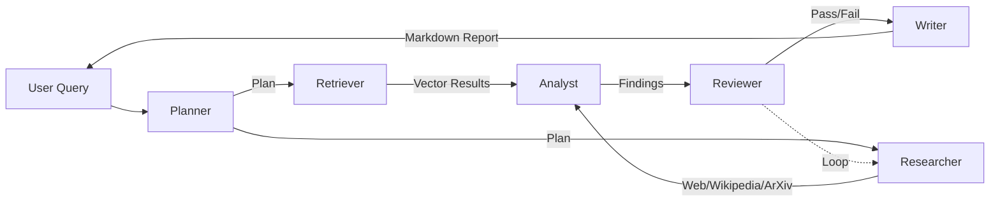

# Multi-Agent Research Assistant

A production-grade, multi-agent AI system that answers complex research questions by orchestrating specialized agents: **Planner**, **Retriever**, **Researcher**, **Analyst**, **Reviewer**, and **Writer**.

Built with **LangGraph**, **Ollama**, **FastAPI**, **Redis**, **Streamlit**, and **Langfuse**.

> Ask any research question, and watch a team of AI agents plan, search the web, retrieve internal documents, analyze findings, review quality, and produce a structured markdown report — all running locally with open-source LLMs.

---

## 🚀 Features

* ✅ **6 Specialized Agents** – Planner, Retriever, Researcher, Analyst, Reviewer, Writer
* ✅ **LangGraph State Machine** – Conditional routing, cycles, shared state, checkpointing
* ✅ **Human-in-the-Loop (HITL)** – Approve research plans before execution
* ✅ **Multiple Research Tools**

  * DuckDuckGo Search
  * Wikipedia
  * ArXiv
  * Calculator
* ✅ **Production-Grade Backend**

  * FastAPI
  * Async processing
  * Error handling
  * Retries
* ✅ **Redis Caching**
* ✅ **Langfuse Observability**

  * Tracing
  * Token tracking
  * Latency monitoring
  * Failure analysis
* ✅ **Streamlit UI**
* ✅ **Local & Private**

  * Runs entirely on Ollama
  * No cloud LLM costs

---

## 🏗️ Architecture



### Agent Responsibilities

#### Planner Agent

* Breaks the user query into sub-questions
* Generates research strategy
* Produces search queries

#### Retriever Agent

* Searches local vector databases
* Retrieves internal documents
* Supports Chroma and FAISS

#### Researcher Agent

* Performs web searches
* Queries Wikipedia
* Searches ArXiv
* Uses external tools

#### Analyst Agent

* Extracts key findings
* Identifies contradictions
* Assigns confidence scores

#### Reviewer Agent

* Validates report quality
* Requests additional research if needed
* Controls iterative improvement loop

#### Writer Agent

* Produces final markdown report
* Organizes findings
* Includes citations and references

---

## 🛠️ Tech Stack

| Category          | Technologies                       |
| ----------------- | ---------------------------------- |
| LLM Orchestration | LangGraph, LangChain               |
| LLM Runtime       | Ollama (Llama 3.2, Phi-3, Mistral) |
| Backend           | FastAPI, Uvicorn                   |
| Frontend          | Streamlit                          |
| Vector Database   | Chroma, FAISS                      |
| Embeddings        | Sentence Transformers              |
| Caching           | Redis                              |
| Observability     | Langfuse                           |
| Search Tools      | DuckDuckGo, Wikipedia, ArXiv       |
| Reliability       | Tenacity Retries                   |
| Concurrency       | ThreadPoolExecutor                 |

---

## 📋 Prerequisites

* Python 3.11+
* Ollama installed and running
* Redis (optional but recommended)
* Git

---

## 🔧 Installation

### 1. Clone the Repository

```bash
git clone https://github.com/yourusername/multi-agent-research-assistant.git
cd multi-agent-research-assistant
```

### 2. Create Virtual Environment

```bash
python -m venv .venv
```

#### Windows

```bash
.venv\Scripts\activate
```

#### Linux / macOS

```bash
source .venv/bin/activate
```

### 3. Install Dependencies

```bash
pip install -r requirements.txt
```

### 4. Configure Environment Variables

Create a `.env` file:

```env
OLLAMA_BASE_URL=http://localhost:11434
LLM_MODEL=llama3.2:latest
EMBEDDING_MODEL=BAAI/bge-small-en-v1.5

# Langfuse
LANGFUSE_PUBLIC_KEY=pk-xxxx
LANGFUSE_SECRET_KEY=sk-xxxx
LANGFUSE_HOST=https://cloud.langfuse.com

# Redis
REDIS_URL=redis://localhost:6379
CACHE_TTL=3600

# Optional
TAVILY_API_KEY=
```

### 5. Start Redis (Optional)

Using Docker:

```bash
docker run -d -p 6379:6379 --name redis-cache redis
```

### 6. Pull Ollama Model

```bash
ollama pull llama3.2:latest
```

---

## 🏃 Running the Project

### Start FastAPI Backend

```bash
python main.py
```

API:

```text
http://localhost:8000
```

Swagger UI:

```text
http://localhost:8000/docs
```

---

### Start Streamlit UI

```bash
streamlit run ui_stable.py
```

UI:

```text
http://localhost:8501
```

---

## 📡 API Usage

### Research Endpoint

```bash
curl -X POST "http://localhost:8000/research/" \
-H "Content-Type: application/json" \
-d '{"query":"What is Ollama?","max_revisions":2}'
```

---

### Get Research Result

```bash
curl "http://localhost:8000/research/{task_id}"
```

---

## 👨‍💻 Human-in-the-Loop Workflow

### Start Research

```bash
curl -X POST "http://localhost:8000/research/hitl/start?query=What%20is%20Ollama%3F"
```

### Approve Research Plan

```bash
curl -X POST "http://localhost:8000/research/hitl/approve/{task_id}?approved=true"
```

### Check Status

```bash
curl "http://localhost:8000/research/hitl/status/{task_id}"
```

---

## 📂 Project Structure

```text
multi_agent_research/
├── src/
│   ├── agents/
│   ├── api/
│   ├── cache/
│   ├── graph/
│   ├── tools/
│   ├── observability/
│   ├── evaluation/
│   ├── config.py
│   └── models.py
├── ui_stable.py
├── main.py
├── requirements.txt
├── .env.example
└── README.md
```

---

## 🖥️ Streamlit Features

* Ask research questions
* Real-time progress updates
* Download markdown reports
* Redis caching support
* Adjustable revision settings
* Agent trace visualization

---

## ⚙️ Customization

### Change Model

```env
LLM_MODEL=mistral:latest
```

### Enable/Disable Tools

Modify:

```text
src/agents/researcher.py
```

### Adjust Reviewer Loop

Modify:

```text
src/graph/workflow.py
```

Change:

```python
max_revisions
```

---

## 🧪 Evaluation

```python
from src.evaluation.runner import evaluate_on_test_set

results = evaluate_on_test_set([
    "What is a Large Language Model?",
    "How does LangGraph work?"
])

print(results["avg_coverage"])
print(results["avg_faithfulness"])
```

---

## 🐛 Troubleshooting

| Issue                  | Solution                                   |
| ---------------------- | ------------------------------------------ |
| Ollama not responding  | Ensure `ollama serve` is running           |
| Redis connection error | Start Redis or disable caching             |
| Wikipedia failure      | Falls back to web search                   |
| ArXiv rate limit       | Automatic retry mechanism                  |
| Empty findings         | Verify retrieval and analyst configuration |

---

## 🔮 Future Improvements

* News API integration
* Local file ingestion pipeline
* WebSocket streaming updates
* Docker Compose deployment
* Cloud LLM fallback support
* Persistent vector stores

---

## 🤝 Contributing

Contributions are welcome.

For major changes, please open an issue first to discuss your proposal.

---

## 📄 License

MIT License

---

## 🙏 Acknowledgements

* LangGraph
* LangChain
* Ollama
* Streamlit
* Langfuse
* DuckDuckGo
* Wikipedia
* ArXiv

---

## 📬 Contact

For questions, suggestions, or collaboration opportunities, please open a GitHub issue.

---
